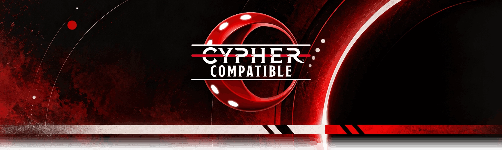

# The Magnus Archives for Foundry VTT

<p align="center">
   
</p>
<p align="center">
 <a href="https://github.com/Achoobert/foundryvtt_magnusarchives/issues"></a> <a href="https://github.com/Achoobert/foundryvtt_magnusarchives/network"></a> <a href="https://github.com/Achoobert/foundryvtt_magnusarchives/stargazers"></a>
</p>

Install in Foundry (Game Systems → Install System → Manifest URL):

```console
https://github.com/Achoobert/foundryvtt_magnusarchives/releases/latest/download/system.json
```

> [!IMPORTANT]
> ## AI-ASSISTED PROJECT
> **This system was developed extensively with AI assistance, including ChatGPT and Codex.**
>
> If you do not want to use software made with AI assistance, **do not use this system.**

> [!WARNING]
> ## EARLY BETA
> **Expect bugs, rough edges and changes.**

> [!NOTE]
> ## FORKS & THANKS
> This system is a fork of **SokK's [Cypher V2](https://github.com/SebsokK/cypherv2)**, which is itself
> a fork of Marko's [Cypher System for Foundry VTT](https://github.com/mrkwnzl/cyphersystem-foundryvtt).
>
> Thank you to **Marko (mrkwnzl)** and **SokK** — this system exists because of their work. ❤️

**The Magnus Archives** (`magnusarchives`) is an unofficial Foundry VTT v14 game system for
*The Magnus Archives Roleplaying Game*, built on Foundry Application V2 with a compact interface
and a rules engine designed to guide play without over-enforcing it.

## How this differs from Cypher V2

The Magnus Archives RPG uses the classic Cypher damage track rather than the new edition's Wounds,
so the core health model here is different from its upstream:

- **Stress** accumulates in points. Every 3 points is one Stress Level, and each Stress Level
  hinders every task (p12).
- **The damage track** runs Hale → Hurt → Impaired → Debilitated → Dead (p132). Hurt is an extra
  step only some characters have — the Tough ability, the Never Says Die focus, or body armor.
- **PCs never take Pool damage from an attack.** An attack gives them Stress, or a serious injury
  that moves them one step down the track.
- **Body armor has no damage-reduction value.** It grants the extra Hurt step and hinders every
  Speed-based task (p100).
- **Prices are categories, not currency** — inexpensive through priceless (p98).
- Species and Genres are not Magnus concepts, and are not shipped.

## Features

- **Foundry VTT v14** native system using Application V2 sheets.
- Character and NPC sheets, and Item sheets for Abilities, Skills, Weapons, Armor, Equipment,
  Cyphers, Artefacts, Descriptors and Types.
- **Might, Speed and Intellect Pools**, Edge, Effort and derived package contributions.
- **Stress and the damage track**, with the impaired Effort surcharge applied to rolls automatically.
- Recovery, Rest, Rally and Non-Rest Recovery workflows. Rest removes 3 points of Stress per hour.
- Skills with quick rolls, configured rolls and mastery levels.
- Shared Roll Dialog and detailed Roll Cards with Effort, modifiers, costs and natural results.
- Hidden/unknown difficulty support for GM-facing NPC difficulties.
- NPCs as the book writes them: a Level, a derived target number, and a list of Modifications.
- Dodge and Block defense workflows, with the attack's effect on a PC declared up front.
- Manual, player-driven **Combat Tracker** with drag-and-drop ordering and `DONE` turns.
- GM Intrusions, Free GM Intrusions and Player Intrusions.
- **Horror Mode** with a GM-controlled Intrusion Range from 1 to 20.
- Descriptor and Type package automation with provenance-aware grants and choice dialogs.
- Character Advancement with Tier progression.
- Native ProseMirror rich-text editing on Application V2 sheets.

## Included compendiums

- **Descriptors** (`descriptors`) — the 27 descriptors from chapter 2
- **Skills** (`skills`) — the 47 skills from the skill list, plus the three defense tasks
- **Types** (`types`) and **Type Abilities** (`type-abilities`) — Investigator, Protector,
  Elocutionist and Occultist, with every tier's ability options (chapter 3)
- **Foci** (`foci`) and **Focus Abilities** (`focus-abilities`) — the 18 foci of chapter 4, and a
  "Serves as an Avatar" focus per Entity (p89-96)
- **Weapons & Armor** (`weapons-and-armors`) — the weapons from the price tables, and body armor
- **Equipment** (`equipment`) — the rest of the price tables, by price category
- **Cyphers** (`cyphers`) and **Cypher Tables** (`cypher-tables`) — the Magnus cyphers and the d00
  Cypher Table (chapter 6)
- **Artefacts & Books** (`artefacts`) — chapter 13
- **NPCs & Monsters** (`npcs`) — chapter 12, foldered by Entity, plus the animals and people of p195
- **Example Characters** (`example-characters`) — the sample character sheet (p379-380)

### Known gaps

- A type's Edge can only target one Pool, so the Investigator's and Protector's second Edge, the
  Occultist's Might of 7, and type cypher limits are set by hand. Each type's description has a
  "Sheet notes" line.
- Avatar foci put Sense Avatar and Sense Supernatural Activity at Tier 1 so the tree can unlock the
  Entity powers; the GM attaches an Avatar focus only from Tier 4.

The CRD `types`, `foci`, `species`, `genres` and `genre-abilities` content and importers are still in
the repository but are not built or shipped. Do not run `import:types` or `import:foci`: they write
the same pack folders as the Magnus content.

## Development

Requirements:

- Node.js 22.13 or later
- pnpm 11.19.0 (the version pinned by the repository)
- Foundry VTT 14.360 for runtime testing
- Docker, for the local Foundry container

Install and verify:

```bash
pnpm install
pnpm check          # typecheck + unit tests + build
```

### Local Foundry loop

Copy `fvtt.config.example.js` to `fvtt.config.js` and fill in your paths, then:

```bash
pnpm build              # Vite bundle + compendium packs
pnpm dev:world          # create the dev world
pnpm dev:sync           # copy the system into Data/systems/magnusarchives
pnpm test:quench:sync   # copy the Quench test module into Data/modules
pnpm dev:seed           # enable Quench and set the dev GM password (Foundry must be stopped)
pnpm watch              # vite build --watch + re-sync on every change
```

`pnpm dev:seed` exists because Foundry v14 refuses to join a user with no password, so the dev
world needs a known one for the Cypress suite. It writes directly to the world's LevelDB, so stop
Foundry first.

### Tests

| Command | What it runs |
| --- | --- |
| `pnpm test` | vitest unit tests |
| `pnpm test:e2e` | Cypress against a live Foundry, including the Quench suite |
| `pnpm test:e2e:open` | the same, in the Cypress UI |

Quench batches live in `tests/quench/` and run inside a live world. Cypress drives them and fails
if the pass count is zero, because a broken `registerBatch` fails silently.

## Manual installation

Clone or copy the repository as `magnusarchives` directly under the Foundry data directory:

```text
Data/systems/magnusarchives
```

Then run the build and restart Foundry. For normal installation and updates, use the manifest:

```text
https://github.com/Achoobert/foundryvtt_magnusarchives/releases/latest/download/system.json
```

## Content and licensing

This is an **unofficial fan-made system**. It is not an official Rusty Quill, Monte Cook Games or
Foundry Virtual Tabletop product, and is not affiliated with any of them.

*The Magnus Archives* is co-created by Jonathan Sims and Alexander J Newall and distributed by
Rusty Quill Ltd. The Magnus Archives Roleplaying Game is © 2024 Rusty Quill. Cypher System content
is © 2024 Monte Cook Games, LLC, published under the Cypher Open License at
https://col.montecookgames.com.

Rusty Quill's intellectual property is **not** covered by the Cypher Open License. Entity names,
artefacts and podcast characters need separate permission before they are distributed here.

The project code is MIT licensed. See:

- [LICENSE.md](LICENSE.md)
- [Content Sources](legal/CONTENT-SOURCES.md)
- [Third-Party Notices](legal/THIRD-PARTY-NOTICES.md)
- [Asset Licenses](legal/ASSET-LICENSES.md)
